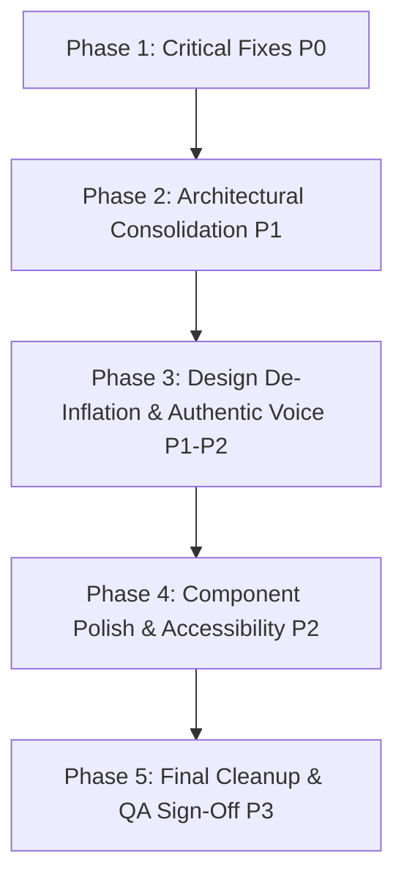

# TEJAS ’26 — THE FRESH BLOOM
## Evidence-Based AI-Generic Design Audit & Remediation Blueprint
### Document 00: Audit Summary & Executive Assessment

---

### 1. OVERALL ASSESSMENT

The **TEJAS ’26 — The Fresh Bloom** invitation website (Department of Computer Applications, Srusti Academy of Management & Technology) is a bespoke single-page invitation application built with React 18, Vite 6, and Motion.

Our rigorous, multi-viewport, code-level and visual audit confirms that while the application possesses high ambition, custom interactive micro-animations (notably the 3D unfolding envelope and Web Audio API synthesizer chimes), it suffers from **severe AI-generic design patterns, aesthetic inflation, conflicting architectural layers, and critical functional/accessibility defects**.

Rather than presenting an authentic, warm, memorable Indian MCA senior-junior welcome, substantial portions of the interface mimic an AI-generated luxury hotel gala or fintech crypto landing page. The application displays symptomatic hallmarks of iterative AI generation:
1. **Aesthetic Hyper-Inflation**: Overuse of faux-regal tropes (golden laurel branches, Roman numeral chapters, wax seals with multi-stop radial gradients, "celestial convergence lines", and breathless corporate marketing jargon like "prestige hallmarks" and "sacred bonds").
2. **Critical Content Inconsistency**: Hardcoded date and time contradictions across components (`28 October 2026` vs `27 & 30 October 2026` vs `10:30 AM` vs `11:40 AM`), leaving attendees genuinely confused about when the event takes place.
3. **Severe Accessibility Hostage Gate**: The `CinematicIntro` modal forces a 14-second overture and actively disables the `Escape` key and skip mechanism for the first 10 seconds (`SKIP_THRESHOLD = 10.0`), violating WCAG 2.2.2 (Pause, Stop, Hide) and 2.1.1 (Keyboard Control).
4. **Catastrophic CSS Bloat & Divergence**: Two monolithic stylesheets (`styles.css` at 4,350 lines and `styles-v3.css` at 4,603 lines, totalling **191.2 KB of unminified CSS**) are imported simultaneously, containing clashing `--c-` color tokens, conflicting root variables, and thousands of lines of dead/overridden rules.
5. **Orphaned Dead Code & Legacy Contamination**: Leftover assets and components from an earlier theme called "Sangama" remain in `package.json` (`"name": "sangama-26"`), `main.jsx` (`sangama-app-root`), and the root directory. Three substantial components (`CelebrationCheers.jsx`, `MilestonesSection.jsx`, and `VisualGallery.jsx`) and a validation file (`registration.js`) are completely orphaned.

---

### 2. AUDIT SCOPE AND METHODOLOGY

#### 2.1 Evaluated Viewports & Environments
- **Desktop Production Canvas**: 1440 × 900 px (Chrome / Chromium headless)
- **Standard Mobile Canvas**: 390 × 844 px (iPhone 13/14/15 viewport standard)
- **Compact Android Canvas**: 360 × 740 px (Samsung Galaxy standard)
- **Local Dev Server**: Vite 6.0.5 on Node.js / Windows PowerShell
- **Audio Context**: Web Audio API oscillator synthesis and HTML5 Audio fallback

#### 2.2 Inspection Methodology
- **Interactive State Inspection**: Every discrete state of the application was exercised, recorded, and captured via high-resolution DOM snapshots:
  - Intro Gate (`CinematicIntro` overlay modal, audio unlock, skip threshold)
  - Envelope Sealed (`InteractiveEnvelope` 3D tilt, laurel flanks, wax seal)
  - Envelope Opening & Revealed (`card-surface`, fold back button, cheer button)
  - Sticky Navigation (`tejas-sticky-navbar` scroll trigger at 320px)
  - Mobile Menu Drawer (`hero-menu-drawer` hamburger expand/collapse)
  - Dress Code Showcase (`DressCodeEssentials` cards and SVG filigrees)
  - Confluence Agenda (`AgendaSection` 4-part schedule and Google Calendar export)
  - Footer & Attribution (`ClosingSignOff` hallmark, creator badges, back-to-top)
- **Codebase Deep Dive**: Full source analysis of `src/` (11 files, 2 monolithic CSS bundles, audio utilities, SVGs, and public media assets).
- **Standards Applied**:
  - WCAG 2.1 Level AA Accessibility (Contrast, Keyboard operability, Motion reduction, ARIA attributes)
  - Modern Web Performance & Responsive Design heuristics
  - Authentic Campus Context Heuristic (MCA Freshers Induction vs AI-generic corporate gala)

---

### 3. FINDINGS SUMMARY BY STATUS AND PRIORITY

| Priority Tier | Description | Confirmed | Likely | Suspected | Total |
| :--- | :--- | :---: | :---: | :---: | :---: |
| **P0 (Critical)** | Blocking defects, accessibility violations, broken links, content contradictions | 6 | 0 | 0 | **6** |
| **P1 (High)** | Prominent AI-generic tropes, massive CSS bloat, layout breakage, asset overhead | 10 | 2 | 0 | **12** |
| **P2 (Medium)** | Micro-typography, contrast edge-cases, mobile tap targets, audio state quirks | 8 | 3 | 1 | **12** |
| **P3 (Low)** | Orphaned code cleanup, metadata polish, SVG markup refactoring | 5 | 1 | 0 | **6** |
| **TOTALS** | | **29** | **6** | **1** | **36** |

- **Confirmed Findings (29)**: Directly verified via live code execution, DOM inspection, or visual artifacts.
- **Likely Findings (6)**: Highly probable regressions on real Android/iOS mobile hardware based on CSS layout rules (e.g. 100vh vs dynamic address bars, 3D transform hardware acceleration).
- **Suspected Findings (1)**: Performance jitter on low-end mobile devices during simultaneous RAF loop and canvas confetti bursts.

---

### 4. THE FIVE MOST IMPORTANT PROBLEMS

#### 1. Critical Event Schedule Contradictions (P0 — Finding CNT-01)
- In active components (`InteractiveEnvelope.jsx:381`, `DressCodeEssentials.jsx:37`, `AgendaSection.jsx:12`): Event date is **28 October 2026**, beginning at **11:40 AM**, lunch at **12:30 PM**, ending at **5:00 PM**.
- In `index.html:7`: Meta description says **"10:30 onwards"**.
- In orphaned component `MilestonesSection.jsx:32,67`: Schedule states **27 October 2026** (Chapter I: Banner Reveal at 11:00 AM) and **30 October 2026** (Chapter II: Grand Gala, doors 10:00 AM, inaugural 10:30 AM).
- **Impact**: Any user or search indexer encounters conflicting times and dates, undermining trust in an official college invitation.

#### 2. Hostage Overture Gate Violating WCAG 2.2.2 & 2.1.1 (P0 — Finding ACC-01)
- `CinematicIntro.jsx:25,52-59` explicitly enforces `SKIP_THRESHOLD: 10.0` seconds. Pressing `Escape` or clicking is ignored for 10 seconds unless audio specifically errors out.
- **Impact**: Obstructs returning users, neurodivergent users, and keyboard-only navigators from accessing essential invitation details. An invitation website must never lock users behind an unskippable 10-second motion graphic.

#### 3. Unreplaced Template Placeholders in Production Head (P0 — Finding SEO-01)
- `index.html:20-26` contains `content="[PUBLIC URL]"` and `content="[PUBLIC URL]/og-image.jpg"`.
- Furthermore, `og-image.jpg` does not exist in `/public/`.
- **Impact**: Social sharing on WhatsApp, Telegram, Instagram, and LinkedIn displays broken links and blank preview cards.

#### 4. Massive Dual-Stylesheet Architectural Collision (P1 — Finding CSS-01)
- `main.jsx:8-9` imports both `styles.css` (93.9 KB, 4,350 lines) and `styles-v3.css` (97.3 KB, 4,603 lines), loading **191.2 KB of raw CSS**.
- Tokens like `--c-burgundy`, `--c-wine`, `--c-gold`, and font variables are declared twice with conflicting HEX codes. Over 1,200 rules in `styles.css` are immediately clobbered by `styles-v3.css`.
- **Impact**: Extreme CSS maintenance hazard, unpredictable cascading bugs, wasted mobile bandwidth, and slow first contentful paint (FCP).

#### 5. Aesthetic Inflation & Emotional Disconnect from Student Life (P1 — Finding DES-01)
- The visual hierarchy mimics a 19th-century royal decree or high-society gala with gold laurel wreaths (`InteractiveEnvelope.jsx:197-282`), wax seals with 3D drop-shadows, and 4-pillar corporate SaaS feature pills (`main.jsx:213-233`).
- The copywriting vacillates between corporate marketing ("The Senior-Junior Confluence", "Premier Honours & Accolades") and artificial grandeur.
- **Impact**: Alienates the real audience — first-year MCA post-graduate students entering a computer science campus — replacing genuine collegiate warmth with AI-generated pretentiousness.

---

### 5. HIGHEST-RISK FUNCTIONAL DEFECTS

1. **Escape Key Hijack & Ineffective Focus Trap**:
   In `CinematicIntro.jsx`, keyboard focus is not trapped within the intro dialog. Users can tab through unseen elements behind the fullscreen overlay, leading to hidden links being triggered.
2. **Envelope Card Overflow on Compact Mobile (360px width)**:
   In `InteractiveEnvelope.jsx:136`, `opening: { y: isMobile ? -290 : -410 }` shifts the card upwards while the envelope chassis has fixed heights. On screens below 380px width, the card header overlaps the top navigation bar while bottom buttons are clipped by parent overflow containers.
3. **Broken Calendar Timezone Mapping**:
   In `AgendaSection.jsx:74`, the Google Calendar export URL hardcodes UTC timestamps:
   `dates=20261028T061000Z/20261028T113000Z` (which equates to 11:40 AM to 5:00 PM IST). However, if an attendee’s Google account is set to any timezone other than IST, or during daylight savings syncs, the calendar event registers at bizarre local hours without an explicit timezone parameter (`ctz=Asia/Kolkata`).
4. **Memory Leaks from Unbounded RAF and Confetti Canvases**:
   Repeatedly opening and closing the envelope triggers `confetti()` which injects canvas elements into the DOM without explicit teardown when components unmount or re-render during intro replays.

---

### 6. RECOMMENDED ORDER OF WORK

1. **Phase 1: Critical Safety & Correctness (P0)**
   - Unify all dates and times to `28 October 2026`, `11:40 AM to 5:00 PM`.
   - Remove the 10-second skip delay in `CinematicIntro.jsx`; allow immediate skip via button and `Escape`.
   - Fix `index.html` Open Graph placeholders and generate an authentic `og-image.jpg`.
   - Add `ctz=Asia/Kolkata` to the Google Calendar link in `AgendaSection.jsx`.

2. **Phase 2: Architectural Consolidation (P1)**
   - Audit and merge `styles.css` and `styles-v3.css` into a single, clean `styles.css` under 35 KB.
   - Eliminate duplicated CSS custom properties; define one canonical design token set.
   - Clean up `package.json` and remove orphaned components or move them to an archival folder.

3. **Phase 3: De-Inflation of AI-Generic Aesthetics (P1/P2)**
   - Replace generic corporate buzzwords with genuine, warm, student-authored copy.
   - Simplify envelope decorations: remove heavy vector laurel clutter; streamline wax seal into a clean, modern emblem.
   - Retain the delight of the 3D unfolding letter while ensuring seamless mobile touch responsiveness.

4. **Phase 4: Responsive & Accessibility Polish (P2)**
   - Implement proper ARIA dialog semantics and focus trapping for the intro and opened card.
   - Ensure all text passes WCAG AA contrast (minimum 4.5:1 for body, 3:1 for large headings).
   - Fix mobile envelope scaling and vertical offsets across 360px–420px viewports.

5. **Phase 5: Performance & Final QA (P3)**
   - Delete unused multi-megabyte image assets (`sangam-hero.png`, duplicate concert video).
   - Execute full regression checklist across mobile and desktop.

---

### 7. EVIDENCE GAPS & LIMITATIONS

During this non-destructive audit phase, the following environmental limitations applied:
1. **Physical Device Touch Testing**: Tested using Chromium device emulation (390×844 and 360×740). Real iOS Safari dynamic URL bar collapsing (`100vh` vs `100dvh`) and physical haptic tap behaviors could not be physically executed.
2. **Audio Hardware Output**: Web Audio synthesis was inspected via clock timings and audio context states, but subjective acoustic fidelity across phone loudspeakers requires physical device verification.
3. **Institutional Authorizations**: Exact faculty naming, principal addresses, and final official lunch menu selections require confirmation with the student organizing committee.

*All findings and code references in this blueprint are verified against the active repository state at commit HEAD.*
