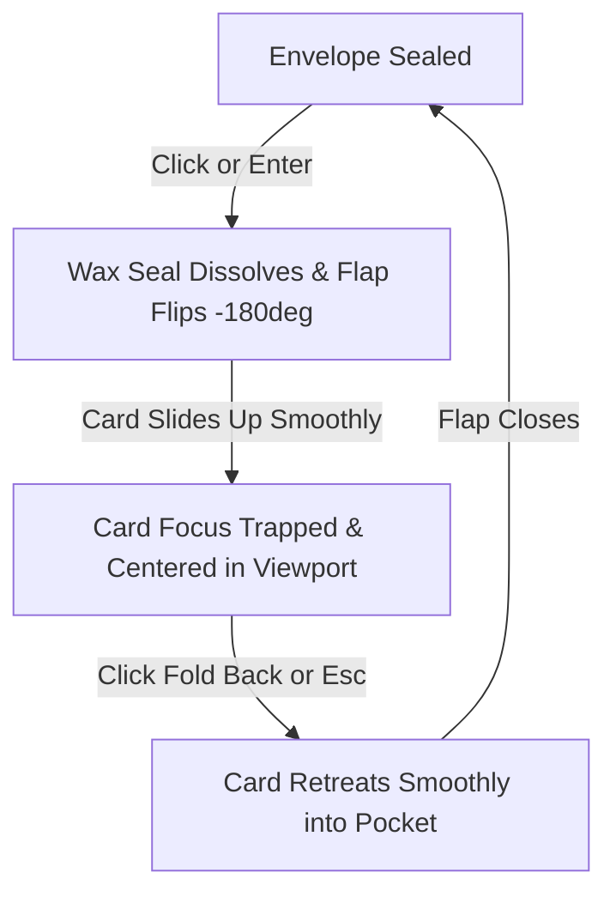

# TEJAS ’26 — THE FRESH BLOOM
## Evidence-Based AI-Generic Design Audit & Remediation Blueprint
### Document 03: Interactive Envelope & Invitation Card Audit

---

### 1. ARCHITECTURAL & INTERACTIVE OVERVIEW

The **Interactive 3D Envelope** (`InteractiveEnvelope.jsx`, 578 lines, 29.1 KB) serves as the experiential centerpiece of the TEJAS ’26 website. It is designed to emulate the ritual of unsealing a physical ceremonial envelope to reveal a gilded parchment invitation letter.

The interaction is orchestrated through a finite state machine:
`SEALED` → `OPENING` (720ms duration) → `REVEALED` → `CLOSING` (700ms duration) → `SEALED`.

While the motion choreography and procedural Web Audio chimes (`playPaperRustle`, `playCelestialRevealChime`) are ambitious, the component exhibits severe visual over-embellishment, mobile clipping bugs, focus-loss defects, and AI-typical aesthetic inflation.

---

### 2. STATE-BY-STATE INTERACTION CHECKLIST

```
[✓] = Working correctly
[!] = Usability or visual friction
[✗] = Verified defect or failure
```

| State | Transition Trigger | Expected Interaction | Observed Reality & Defect Status |
| :--- | :--- | :--- | :--- |
| **1. SEALED** | Initial render or post-close | Sealed red velvet envelope with wax seal, gold seam trim, and 3D mouse parallax tilt. | **[!]** Desktop mouse tilt works smoothly, but touch move on mobile causes slight scroll stutter. Heavy laurel branches clutter sides. |
| **2. TRIGGER OPEN** | Tap wax seal, tap body, press `Enter`/`Space`, or click hero button | Phase switches to `OPENING`; flap hinges open along top edge (-180° `rotateX`). | **[✓]** Flap opens smoothly; paper rustle audio fires synchronously. |
| **3. CARD REVEAL** | Timer timeout (720ms delay) | Card slides upwards out of pocket; confetti shoots; audio chime plays; phase = `REVEALED`. | **[✗]** On mobile (360px–390px), card translates `-290px`, causing the top header to collide with the sticky navbar while action buttons clip below. |
| **4. REVEALED (READING)** | Idle in opened state | Card is fully legible. User can read salutation, view schedule details, click CTAs, or reseal. | **[✗]** Keyboard focus drops into void; user cannot Tab directly into card controls without cycling through background DOM. |
| **5. TRIGGER CLOSE** | Click "Fold Back", press `Escape`, or click seal | Phase switches to `CLOSING`; card retreats into pocket; flap folds back down (0° `rotateX`). | **[✓]** Reseals cleanly; confetti is not re-triggered. |
| **6. HERO CTA SYNC** | Click "Open Letter Directly" in hero | Prop `isLetterOpen` switches to `true`; envelope opens and scrolls smoothly into center. | **[!]** Causes jarring double-animation if user was already in middle of a scroll gesture. |

---

### 3. VERIFIED BUGS & TECHNICAL FAILURE POINTS

#### Bug ENV-BUG-01: Mobile Card Vertical Clipping & Sticky Nav Collision
- **Severity**: P0 (High-Impact Visual / Functional Defect)
- **Source**: `InteractiveEnvelope.jsx:136-137`
- **Code Extract**:
  ```javascript
  const cardV = {
    sealed: { y: 32, opacity: 0, scale: 0.97 },
    opening: { y: isMobile ? -290 : -410, opacity: 1, scale: 1 },
    revealed: { y: isMobile ? -290 : -410, opacity: 1, scale: 1 },
    closing: { y: 32, opacity: 0, scale: 0.97 }
  };
  ```
- **Reproduction**:
  1. Open Chrome DevTools in Mobile Emulation mode (360 × 740 px or 390 × 844 px).
  2. Tap the Wax Seal to open the envelope.
  3. Observe that the card translates upwards by `-290px`.
- **Failure Consequence**:
  - The card's department banner (`DEPARTMENT OF COMPUTER APPLICATIONS`) and monogram are shoved underneath the `.tejas-sticky-navbar` (which sits at `z-index: 1000`).
  - The bottom buttons (`View Programme` and `Cheer for us`) end up resting behind the envelope front pocket face, cutting off touch tap targets.
- **Root Cause**: Hardcoded pixel offsets (`-290px` / `-410px`) fail across variable mobile viewports and dynamic browser address bar changes.

#### Bug ENV-BUG-02: Keyboard Focus Loss on Card Reveal
- **Severity**: P1 (WCAG 2.4.3 Focus Order & 2.1.1 Keyboard Violation)
- **Source**: `InteractiveEnvelope.jsx:188`
- **Code Extract**:
  ```jsx
  tabIndex={isSealed ? 0 : -1}
  role="button"
  aria-label={isSealed ? 'Sealed invitation envelope. Press Enter or Space to open.' : 'Opened envelope'}
  ```
- **Reproduction**:
  1. Navigate to the envelope using the `Tab` key. Focus lands on the sealed chassis.
  2. Press `Enter`. The envelope opens.
  3. Press `Tab` again.
- **Failure Consequence**: Focus does not shift to the opened card, the `Fold Back` button, or the internal links. Instead, focus vanishes into the document body, requiring 7–10 Tab presses to locate the next active element.
- **Root Cause**: The container sets its own `tabIndex` to `-1` when open, but does not imperatively set focus to the card (`cardRef.current.focus()`).

#### Bug ENV-BUG-03: Multiple Confetti Canvas DOM Accumulation
- **Severity**: P2 (Memory / GPU Resource Leak)
- **Source**: `InteractiveEnvelope.jsx:58-65, 428-434`
- **Code Extract**:
  ```javascript
  confetti({
    particleCount: 90,
    spread: 75,
    origin: { y: 0.55 },
    colors: ['#E5B957', '#C89B38', '#7A1030', '#FCE7A2', '#FDF8F0'],
    gravity: 0.85,
  });
  ```
- **Reproduction**: Repeatedly open and close the envelope 10 times, or tap "Cheer for us" multiple times.
- **Failure Consequence**: `canvas-confetti` creates independent `<canvas>` elements injected directly into the document root. Under low-memory mobile browsers (WebKit / Android WebView), accumulated canvas contexts cause noticeable frame drops and potential tab reload.
- **Root Cause**: Missing dedicated canvas reuse or explicit `confetti.reset()` teardown.

---

### 4. VISUAL & AESTHETIC AUDIT (AI-GENERIC PATTERNS)

#### 4.1 Faux-Roman Imperial Laurel Branches (`InteractiveEnvelope.jsx:196-282`)
- **Observation**: Two enormous SVG laurel branches with 14 individually stroked leaves, bevel highlights (`laurelLeafGradL`), and SVG drop-shadow filters (`#laurelBranchShadow`) frame the envelope.
- **Critique**: This is a direct byproduct of AI image/code generation prompted with "luxurious royal invitation". Laurel wreaths are classic Roman/Hellenistic symbols of imperial victory. In the context of an MCA freshers' party at an Indian technical institute, it looks completely synthetic and visually overwhelming.
- **Remediation**: Eliminate the flanking laurels entirely. Replace them with clean, spacious padding that lets the envelope chassis breathe, or introduce delicate, culturally resonant botanical accents (e.g. subtle lotus buds or Odissi scrollwork).

#### 4.2 Over-Complex Wax Seal Medallion (`InteractiveEnvelope.jsx:483-566`)
- **Observation**: The wax seal combines:
  - 1 outer beveled gold rim
  - 1 inner ruby wax disc
  - 2 concentric beaded gold rings
  - 1 internal circular laurel wreath with 18 tiny leaves
  - 1 central 5-pointed gold star with 6 multi-tone shadow polygons
- **Critique**: Visual over-saturation. The seal contains over 40 distinct vector path nodes crammed into an 80×80px circle. When rendered on standard screens, the details blur into an illegible muddy artifact.
- **Remediation**: Simplify to a clean, tactile wax seal stamp featuring:
  - Rich single-stop or two-stop deep crimson wax tone.
  - A clean, debossed **Tejas Lotus** icon or the letter **"T"**.
  - Crisp, realistic wax rim contours without Soviet star / Roman laurel dissonance.

#### 4.3 Faux-Parchment Card Typography Clutter (`InteractiveEnvelope.jsx:347-410`)
- **Observation**: Inside the card, there are 8 stacked text blocks:
  1. Monogram `T` + Department Name + Institution Name
  2. "Fold Back" button
  3. Hairline Rule
  4. Eyebrow: "You are cordially invited to"
  5. Title: "TEJAS '26" + "The Fresh Bloom"
  6. Body paragraph (45 words dense narrative)
  7. Two split date boxes ("Event Date & Time" / "Venue & Lunch")
  8. Sign-off quote + "Your Seniors" badge
  9. Two action buttons
- **Critique**: The card attempts to display an entire website's worth of information on a small simulated parchment sheet. On mobile screens, it feels cramped, suffocated, and difficult to scan.
- **Remediation**:
  - Let the card be an **invitation**, not a full agenda.
  - Highlight the core message: *You are invited · Date · Venue · Reporting Time*.
  - Use the primary button (`View Full Programme ↓`) to guide the user naturally down to the dedicated schedule section below.

---

### 5. DESIGN CORRECTIONS & ACCEPTANCE CRITERIA



#### Acceptance Criteria for Remediated Envelope:

1. **AC-ENV-01 (Responsive Viewport Containment)**:
   - On viewports from 320px to 1920px width, when the card is revealed, 100% of the card content (from top institution header to bottom CTA buttons) must be fully visible and reachable without overlapping sticky navigation or overflowing outside parent bounds.
2. **AC-ENV-02 (Keyboard Focus Flow)**:
   - When the user presses `Enter` on the sealed envelope, after the reveal animation completes (720ms), focus MUST automatically shift to the `.card-reseal-btn` ("Fold Back") or the card container with an accessible outline.
   - Pressing `Escape` while in the `REVEALED` state must trigger the close sequence and return focus to the sealed envelope chassis.
3. **AC-ENV-03 (Aesthetic De-Cluttering)**:
   - Eliminate flanking laurel SVGs (`.env-flank-laurel`) to reduce DOM node overhead by at least 80 nodes.
   - Refactor wax seal SVG from 83 lines to under 25 lines of clean, meaningful vector paths representing the Tejas identity.
4. **AC-ENV-04 (Motion Accessibility)**:
   - When `prefers-reduced-motion: reduce` is active:
     - No 3D tilt calculations or rotation transitions.
     - Flap and card switch instantly (0ms delay) without intermediate scaling.
     - Confetti bursts are completely disabled.
